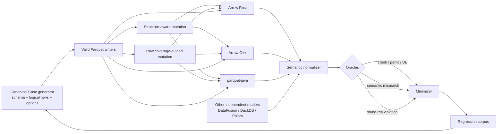
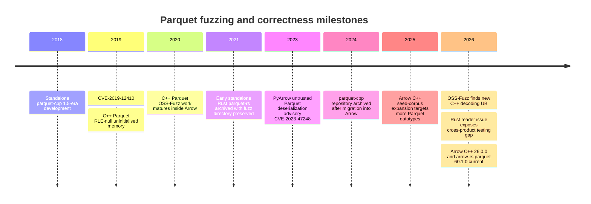
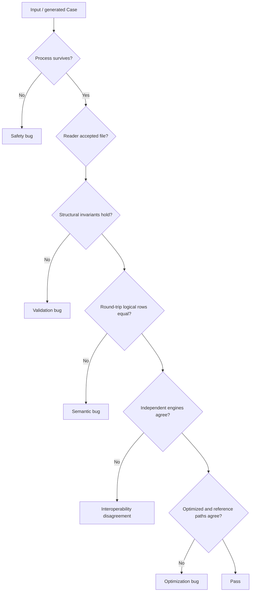
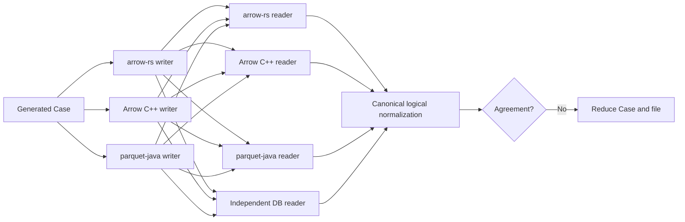

# Fuzzing and Correctness Testing Apache Parquet: Rust, C++, and the OSS Security Ecosystem

> Research note collected 2026-11-01, kept as previous art for zig-parquet.
> Inline chat-citation markers from the original were removed; the text is otherwise unchanged.
> Version numbers and dates are as of that research and will age.

## Executive summary

Apache Parquet has unusually good raw material for rigorous correctness testing: a language-neutral format specification, a substantial shared interoperability corpus, independent implementations in Rust, C++ and Java, and a mature continuous-fuzzing deployment for the C++ implementation. The strongest production fuzzing programme today is Apache Arrow C++'s Parquet integration with OSS-Fuzz. It exercises full-file reads, encoders/decoders, encryption, page indexes, Bloom filters, metadata paths and multiple batch sizes; its seed corpus combines generated valid files with both valid and intentionally bad files from `apache/parquet-testing`. OSS-Fuzz in turn runs compatible harnesses under libFuzzer, AFL++, Honggfuzz and, experimentally, Centipede, with sanitizers and distributed ClusterFuzz execution.

The Rust situation is materially different. The official `apache/arrow-rs` `parquet` crate is mature and actively released—`60.1.0` was published on 28 October 2026—and its test dependencies include `proptest`, `criterion`, snapshot testing and randomized test infrastructure. However, the public evidence I found does **not** show an equivalent current `arrow-rs` Parquet integration in OSS-Fuzz or a first-class `cargo-fuzz`/libFuzzer campaign comparable to C++. Instead, Rust has targeted randomized “fuzz” tests and property-based tests. A particularly revealing August 2026 issue documents a correctness bug that survived because four individually tested features—predicate pushdown, page pruning, mask-backed row selection and predicate caching—had never been tested in combination. The proposed fix is precisely the sort of cross-product, differential property testing that should become the centre of a Rust correctness programme.

The highest-value opportunity is therefore **not simply “more byte fuzzing.”** It is a layered programme combining: malformed-file coverage-guided fuzzing; schema-aware generation; property-based writer/reader round trips; metamorphic testing; independent cross-engine differential testing; systematic feature-combination generation; and regression preservation. This matters because many important Parquet failures are semantically valid enough to pass the parser yet wrong at a higher layer—for example a 2026 `arrow-rs` bug where Parquet files written with page indexes were interpreted by parquet-mr/Spark/Trino as containing zero rows.

The security record supports that conclusion. The clearest historical C++ Parquet CVE, CVE-2019-12410, involved uninitialised Arrow array memory while reading RLE null data from Parquet in Arrow 0.12.0–0.14.1. More recent OSS-Fuzz findings continue to expose undefined behaviour in C++ Parquet decoding. Adjacent ecosystem CVEs also show why differential-oracle processes must themselves be sandboxed: vulnerable historical PyArrow versions allowed arbitrary code execution when deserialising untrusted Parquet input, as did affected Arrow R releases; parquet-avro has had a schema-parsing RCE under particular Java object models.

My recommended priority order is:

1. Put `arrow-rs/parquet` into continuous OSS-Fuzz or an equivalent `cargo-fuzz` programme, with ASan/UBSan where applicable and panic/OOM/hang detection.
2. Build a **shared semantic Case generator** capable of producing schemas, Arrow values, writer properties, encodings, page layouts, compression, encryption and read-time optimisation settings.
3. Execute every generated Case against at least three independent implementation families: Arrow Rust, Arrow C++, and parquet-java; use PyArrow only as a convenient C++ frontend, **not** as an independent C++ oracle because PyArrow is based on Arrow C++.
4. Treat `apache/parquet-testing` as the baseline corpus, not the entire corpus: continuously add minimized fuzz failures and machine-generated boundary cases.
5. Add format-aware mutation that understands the footer, Thrift metadata, row groups, column chunks, page headers, indexes and encodings rather than relying predominantly on arbitrary byte mutation.
6. Measure **semantic state-space coverage** in addition to line/edge coverage: schema depth, physical/logical types, repetition levels, encodings, codecs, page versions, statistics, indexes, filters, encryption modes, null distributions, page boundaries and reader optimisation combinations.

A useful way to think about the programme is:



## Implementation and resource inventory

### Core Rust and C++ libraries

| Implementation | Current / relevant version | Maintainer / governance | Language | Build system | Correctness-testing relevance |
|---|---:|---|---|---|---|
| **Apache Arrow Rust `parquet`** (`apache/arrow-rs`) | **60.1.0**, published 28 Oct 2026 | Apache Arrow project; development through GitHub issues/PRs | Rust | Cargo | Official native Rust Parquet implementation; current manifest includes `proptest`, `criterion`, `insta`, `rand`, multiple codecs, CRC and encryption features. |
| **Apache Arrow C++ Parquet** (`apache/arrow/cpp/src/parquet`) | Arrow **26.0.0**, 9 Oct 2026 | Apache Arrow PMC / contributor community | C++ | CMake, commonly Ninja | Current official C++ implementation; Parquet is integrated into Arrow C++ and has the strongest continuous fuzzing deployment. |
| **`parquet2`** (`jorgecarleitao/parquet2`) | Crate line 0.17.x; GitHub release 0.17.0 Nov 2022 | Jorge Carleitao / community | Rust | Cargo | Independent safe-Rust implementation; repository describes it as `unsafe`-free and integration-tested against PyArrow. Valuable as an independent historical/differential implementation, though substantially less active than `arrow-rs`. |
| **Historical `parquet-rs`** (`sunchao/parquet-rs`) | Archived 11 Jan 2021 | Sun Chao / early Rust Parquet community | Rust | Cargo | Predecessor of the Apache Rust implementation. The archived repository contains a dedicated `fuzz/` tree, so it is useful for reconstructing early Rust fuzzing work. |
| **Historical `parquet-cpp`** (`apache/parquet-cpp`) | Final standalone 1.5-era code; archived May 2024 | Apache Parquet/Arrow community | C++ | CMake | Development and build systems were merged into `apache/arrow`; useful for historical regressions, but it is not an independent modern oracle. |
| **`parquet-format-safe`** | Historical/supporting component | Jorge Carleitao | Rust | Cargo | Panic/OOM-oriented Rust implementation of the Parquet Thrift-format layer, associated with `parquet2`; useful when thinking about metadata parser hardening. |

Arrow Rust has an approximately monthly release rhythm, while Arrow C++ is versioned on the main Apache Arrow release train. The latest stable artifacts visible at the research cutoff were `parquet 60.1.0` for Rust and Arrow C++ 26.0.0.

`arrow-rs/parquet` exposes a broad feature surface that a serious fuzzer must vary rather than compiling only defaults: Arrow integration, async reading, JSON, Snappy, Brotli, gzip, LZ4, Zstd, CRC verification, SIMD UTF-8 checking, modular encryption and experimental features. Its dev dependencies include both property testing (`proptest`) and benchmarking (`criterion`).

`parquet2` is useful precisely because it represents a different Rust codebase and design lineage. Its repository describes the implementation as unsafe-free and integration-tested against PyArrow; that makes it useful for triangulation, although its age means it should not be treated as the sole specification oracle.

### Independent comparators and inspection tools

The most important comparator outside Rust/C++ is **Apache parquet-java**, currently advertising release 1.18.1 in its repository/release pages. It is a genuinely separate Java implementation and therefore much more valuable as a semantic oracle for Arrow C++ than PyArrow is.

`parquet-tools` belongs to the parquet-java ecosystem and is useful for metadata inspection and command-line reproducibility. For automated differential testing, prefer the library APIs where possible, because CLI output can change and often loses type-level distinctions; keep `parquet-tools` as a human-readable failure artifact and second-line oracle. The parquet-java changelog and build are Maven-based.

PyArrow is operationally convenient but should **not** be counted as an independent implementation from Arrow C++: Apache's own Python documentation states that PyArrow is based on the C++ implementation, and building PyArrow with Parquet requires the C++ Parquet library.

A recent specialized project, **Parquity**, explicitly targets semantic disagreements between Parquet engines. Its model is strong: a `Case` contains an ordered schema and rows; `check` tests a specified Case, `fuzz` generates and reduces Cases, and `scan` compares how multiple readers interpret an existing file without declaring one reader canonical. That “no privileged oracle” approach is especially appropriate for an interoperability format.

### High-value resource map

| Resource | Type | Annotated relevance |
|---|---|---|
| `apache/arrow-rs` | Primary repository | Official Rust Parquet implementation and its randomized/property tests. |
| `apache/arrow` C++ Parquet | Primary repository | Current C++ implementation and fuzz targets; basis of PyArrow Parquet. |
| `google/oss-fuzz` Arrow integration | Security infrastructure | Continuous distributed fuzzing; supports libFuzzer, AFL++, Honggfuzz and experimental Centipede configurations. |
| OSS-Fuzz Fuzz Introspector | Coverage observability | Provides current per-target coverage signals for Arrow fuzzers. |
| `apache/parquet-testing` | Shared corpus | Canonical interoperability/regression files, including unusual encodings, page indexes, encrypted data and intentionally problematic files. |
| `apache/parquet-format` | Specification | Ground truth for file layout, Thrift metadata and features such as page indexes. |
| `apache/parquet-java` | Independent implementation | Best established non-Arrow semantic comparator. Current repository identifies 1.18.1 as current stable release. |
| Parquity | Differential-testing tool | Generates/reduces Cases and compares reader semantics rather than only crashes. |
| Firebolt FuzzBerg | Structure-aware OSS fuzzer | Supports Parquet ingestion paths, combines structural mutations with Radamsa-style random mutation and does not require unit-level in-process harnesses. |
| FormatFuzzer | Academic framework | Compiles binary-format templates into generators/parsers/mutators and can feed AFL/AFL++; a strong architectural model for a future Parquet grammar-aware mutator. |
| Archived `sunchao/parquet-rs` | Historical Rust resource | Contains a `fuzz/` directory and preserves the early Rust Parquet fuzzing lineage. |

## Correctness failures, CVEs and bug history

Correctness here should be treated as at least five distinct properties:

**Safety** means malformed input must not trigger memory unsafety, undefined behaviour, uncontrolled allocation, stack overflow or process abort. **Structural validity** means invalid Parquet structures are rejected consistently. **Semantic correctness** means decoded logical values, row counts and schemas are right. **Round-trip correctness** means writing and rereading preserves the intended logical table under the format's normalization rules. **Interoperability correctness** means files written by one implementation are interpreted equivalently by independent implementations.

Those categories expose why crash-only fuzzing is insufficient.

### Security advisories with direct or adjacent Parquet impact

| Advisory | Component / affected versions | Failure class | Testing lesson |
|---|---|---|---|
| **CVE-2019-12410** | Apache Arrow 0.12.0–0.14.1, C++ Parquet path | Reading RLE null data from Parquet could leave Arrow array memory uninitialised; C++, Python, R and Ruby bindings were affected; fixed by upgrading to 0.15.1+. | Run UBSan/MSan-class instrumentation and deliberately mutate level/encoding metadata, null counts and RLE streams. |
| **CVE-2019-12408** | Arrow C++ 0.14.0–0.14.1 | Uninitialised memory when building arrays containing nulls; broader Arrow issue rather than Parquet-specific. | Fuzz Parquet conversion paths all the way into Arrow arrays; parser success is not the end oracle. |
| **CVE-2023-47248** | PyArrow 0.14.0–14.0.0 | Untrusted IPC/Feather/Parquet deserialization could lead to arbitrary code execution; fixed in 14.0.1. | Never run historical PyArrow differential oracles unsandboxed on untrusted fuzz input. |
| **CVE-2024-52338** | Arrow R 4.0.0–16.1.0 | Untrusted IPC/Parquet deserialization RCE; fixed in 17.0.0. | Treat all language-binding oracles as potentially vulnerable targets, not “safe tooling.” |
| **CVE-2025-46762** | parquet-avro through affected 1.15.x configurations | Schema parsing could instantiate attacker-controlled classes in specific/reflect models; upgrade to 1.15.2 or harden configuration. | When parquet-java participates in fuzzing, separate raw Parquet correctness tests from higher-level object materialization. |
| **CVE-2021-41561** | parquet-java, affected pre-1.11.2 and 1.12.0–1.12.1 ranges recorded by NVD | Input-validation vulnerability in Parquet Java lineage. | Historical Java versions are useful regression targets but should be isolated. |

The 2019 C++ issue is especially instructive because Apache's advisory says the flaw emerged while investigating UBSan errors. That is exactly the kind of defect ordinary golden-file correctness tests often miss and sanitizer-backed fuzzing finds efficiently.

### Recent correctness evidence in C++

OSS-Fuzz is still finding meaningful C++ issues. Apache Arrow issue #49477, opened 9 March 2026, explicitly records undefined behaviour while decoding Parquet data and states it was found by OSS-Fuzz.

The historical standalone C++ changelog also shows the breadth of non-security correctness classes: dictionary-size-zero failures, incorrect row counts for nested columns, malformed/truncated statistics handling, duplicate-column writer segfaults, null-list conversion failures and metadata/API inconsistencies. These are not one bug family; they span decoding, logical conversion, metadata interpretation and writer semantics.

### Recent correctness evidence in Rust

The strongest current Rust signal is issue #10747. A bug shipped because predicate pushdown, page pruning, mask-backed row selection and predicate caching were individually tested but not tested together. The issue proposes expanding `test_fuzz_async_reader_selection` across filter presence, cache sizes, `RowSelectionPolicy`, batch size, overlapping projections and page/row-group sizes; it also explicitly asks for a differential oracle against a simpler reference configuration rather than merely checking row count.

That issue is a near-perfect specification for a modern correctness fuzzer: the bug lived in the **cross product of valid features**, not in a malformed byte sequence. It also notes that the existing generator rarely produces sparse patterns such as one selected row followed by a long gap, illustrating why input-distribution design matters as much as randomization.

Another 2026 interoperability issue reports files with page indexes written by `parquet-rs` being unreadable correctly by parquet-mr-based consumers, with Spark/Trino producing zero rows. That class of error requires cross-implementation testing; a Rust writer followed by the same Rust reader can easily agree with itself and miss it.

The broader 60.x release programme has also included sustained panic-reduction work in Rust, while the crate maintains explicit support for checksum verification, multiple codecs and encryption—all useful fuzz dimensions.



## Fuzzers, corpora and mutation strategies

### Current C++ programme

OSS-Fuzz's model is a particularly good fit for Parquet. Its standard project integration builds instrumented fuzz targets, preserves source for coverage analysis, packages target-specific seed corpora and can run the same `LLVMFuzzerTestOneInput`-style target through multiple engines. OSS-Fuzz documents libFuzzer, AFL++, Honggfuzz and experimental Centipede support; AFL++ itself documents compatibility with `LLVMFuzzerTestOneInput` harnesses.

Apache Arrow's C++ fuzzing has covered Parquet for years, and recent project work has explicitly expanded the seed corpus. Issue #47597, for example, calls for additional Arrow datatypes such as Boolean, FixedSizeBinary, decimals and temporal types, a newer Parquet format version and storing the Arrow schema so that decoding reconstructs the intended original logical types.

This is important: a high-quality seed corpus is not merely “lots of Parquet files.” It is a carefully selected set that activates distinct code paths.

### Corpus inventory

The shared `apache/parquet-testing` corpus is the foundational interoperability dataset. Its data README includes fixtures for delta encodings, tiny pages, dictionary encoding, page indexes, encrypted Parquet, Bloom filters and many implementation-specific regressions.

A useful corpus taxonomy is:

| Corpus layer | Examples | Purpose |
|---|---|---|
| **Format interoperability fixtures** | `apache/parquet-testing/data` | Cross-engine known-good or edge-case files covering encodings, logical types and optional features. |
| **Known-bad fixtures** | `parquet-testing/bad_data` and implementation regression files | Verify rejection behaviour, robustness and previously fixed bugs. The repository is explicitly for Parquet testing data/utilities. |
| **Generated C++ fuzz seeds** | Files produced by Arrow's Parquet corpus generator | Reach combinations of datatypes, codecs, page versions, encodings and encryption not efficiently discovered by random mutation alone. The ongoing datatype-expansion issue documents this strategy. |
| **Accumulated OSS-Fuzz corpus** | Evolutionary corpus maintained per target | Inputs retained because they increase coverage; OSS-Fuzz documents downloading/restoring accumulated corpora and recommends seed corpora as a major efficiency lever. |
| **Minimized regression corpus** | One minimized file/Case per bug | Permanent deterministic protection against regressions; should be promoted from fuzz findings into repository tests. |
| **Semantic Cases** | Schema + logical rows + writer/read options | Lets the same logical test be generated by multiple writers and compared across readers; Parquity uses essentially this representation. |

The testing corpus should be considered a **coverage seed**, not a closed certification suite. The file list itself reflects a history of adding specific edge cases as implementations discover them.

### Mutation strategies

There are four useful mutation layers, and they should coexist.

**Raw byte mutation** is cheap, coverage-guided and excellent for parser hardening. libFuzzer/AFL++/Honggfuzz can mutate length fields, page data, compressed streams and metadata in ways humans would not imagine. Its weakness is that Parquet has strong structural constraints; indiscriminate mutation rapidly destroys footer and page structure, so many executions terminate near the parser entrance. OSS-Fuzz's emphasis on strong seed corpora and dictionaries is intended to alleviate exactly this problem.

**Structure-preserving mutation** keeps enough of the file valid to reach deep reader logic. Firebolt's open-source **FuzzBerg** is relevant here: it supports Parquet ingestion interfaces and describes its mutations as a combination of structure awareness and randomized Radamsa-based mutation, seeded through a PRNG. Its README also notes that its current model is not coverage-guided and identifies coverage-guided prioritization as future work.

For Parquet, a structure-aware mutator should know at least:

```text
PAR1 header
  ├─ row group
  │   ├─ column chunk
  │   │   ├─ dictionary page?
  │   │   ├─ data page(s)
  │   │   ├─ bloom filter?
  │   │   └─ page index / offset index?
  │   └─ ...
  └─ ...
Thrift FileMetaData
footer length
PAR1 trailer
```

**Grammar/format-aware mutation** can go further. Parquet metadata is defined through the format specification and Thrift structures; the format repository is therefore a machine-readable starting point for AST-aware metadata mutation. Page-index semantics, for example, specify relationships between `ColumnIndex`, page min/max values and scan predicates.

FormatFuzzer demonstrates a mature general architecture for this category: compile a binary-format template into C++ that can parse, generate and mutate valid structures, then expose a decision representation to a coverage-guided engine such as AFL. There is no evidence in the sources reviewed that Apache Parquet currently has a complete FormatFuzzer template, so building one would be new work rather than activating an existing integration.

**Schema-aware generation/property testing** is the most important layer for semantic correctness. Instead of mutating bytes, generate:

```text
Schema
× row values / null pattern
× row-group sizing
× data-page sizing
× dictionary thresholds
× page V1/V2
× encoding
× compression
× statistics on/off
× page index on/off
× bloom filter on/off
× checksum on/off
× encryption mode
× Arrow schema metadata
× projection
× predicate
× row selection
× batch size
× async/sync reader
```

The Rust issue #10747 shows why this cross-product matters: each feature may work in isolation while a four-way interaction is wrong.

### Fuzzer comparison

| Technique / tool | Coverage guided | Structure aware | Best use for Parquet | Current evidence |
|---|---:|---:|---|---|
| **libFuzzer** | Yes | No, unless custom mutator | Fast in-process C/C++ or Rust parser/decoder fuzzing | Used through OSS-Fuzz infrastructure. |
| **AFL++** | Yes | Optional custom mutators | Alternative mutation/search heuristics; compatible with `LLVMFuzzerTestOneInput` harnesses | OSS-Fuzz supported. |
| **Honggfuzz** | Yes | No by default | Independent engine diversity, crash/UB discovery | OSS-Fuzz supported. |
| **OSS-Fuzz / ClusterFuzz** | Multi-engine | Depends on target | Continuous distributed fuzzing, sanitizer builds, corpus retention, reporting | Mature Arrow C++ integration. |
| **Rust `proptest`** | No edge coverage feedback | Semantic generators | Valid schema/value/options generation and shrinking | Current `arrow-rs/parquet` dev dependency. |
| **FuzzBerg** | Not currently | Yes | Black-box ingestion/API fuzzing when in-process harnessing is difficult | Parquet supported; structural + randomized mutations. |
| **FormatFuzzer** | Can integrate with AFL++ | Strong | Deep grammar-aware binary mutation/generation | General academic framework; no complete Parquet integration found. |
| **Parquity** | Property/differential rather than edge coverage | Schema/Case aware | Cross-engine semantic disagreement and shrinking | Purpose-built for Parquet. |

## Differential testing and reproducible harnesses

### Oracle hierarchy

A rigorous Parquet fuzzer should not have a single oracle. It should apply an ordered set of properties:



For valid generated files, the strongest inexpensive oracle is usually **logical-table equality**, not encoded-byte equality. Two correct Parquet writers are free to choose different page boundaries, statistics encodings, compression streams and dictionary layouts.

For one implementation, use **metamorphic** comparisons:

- predicate pushdown enabled vs disabled;
- page-index pruning enabled vs disabled;
- row selection mask vs selector form;
- sync vs async reader;
- small vs large batches;
- projection before vs after filtering;
- dictionary vs plain writer where semantics permit;
- page V1 vs V2;
- statistics/Bloom filters present vs absent.

This directly operationalizes the `arrow-rs` issue #10747 recommendation to compare optimized behaviour with a simpler reference configuration.

For cross-implementation testing, use at least Arrow Rust, Arrow C++, and parquet-java. PyArrow is useful as a scripting frontend but does not provide an independent C++ parser because it is based on Arrow C++.

Parquity's `scan` design—compare reader observations without preselecting a reference reader—is particularly sensible when the standard permits multiple representations or when one implementation may itself be wrong.

### Minimal Rust byte harness

The following is a practical starting point for `cargo-fuzz`. It is intentionally small: bytes that do not form a readable file are ordinary rejections; successful reads must not panic.

```rust
#![no_main]

use libfuzzer_sys::fuzz_target;
use bytes::Bytes;
use parquet::arrow::arrow_reader::ParquetRecordBatchReaderBuilder;

fuzz_target!(|data: &[u8]| {
    // Bytes implements the random-access input abstraction used by parquet-rs.
    let input = Bytes::copy_from_slice(data);

    let Ok(builder) = ParquetRecordBatchReaderBuilder::try_new(input) else {
        return;
    };

    let Ok(reader) = builder.with_batch_size(257).build() else {
        return;
    };

    for batch in reader {
        match batch {
            Ok(batch) => {
                // Force materialization/use of basic structural information.
                let _ = batch.num_rows();
                let _ = batch.num_columns();
                let _ = batch.schema();
            }
            Err(_) => return,
        }
    }
});
```

The current `parquet` crate supplies the relevant Arrow reader implementation and already has `proptest` in its dev environment; adding `cargo-fuzz` would complement, rather than replace, those semantic tests.

A production version should have several separate targets rather than one giant target: metadata-only parsing, page decoding, Arrow conversion, full-file reads, encrypted reads, page-index reads and writer→reader round trips. This keeps executions fast and makes coverage deficiencies diagnosable.

A recommended `fuzz/Cargo.toml` skeleton is:

```toml
[package]
name = "parquet-fuzz"
version = "0.0.0"
publish = false
edition = "2024"

[package.metadata]
cargo-fuzz = true

[dependencies]
libfuzzer-sys = "0.4"
bytes = "1"

[dependencies.parquet]
path = "../parquet"
features = ["arrow", "crc", "encryption"]

[[bin]]
name = "read_file"
path = "fuzz_targets/read_file.rs"
test = false
doc = false
bench = false
```

### Minimal C++ libFuzzer harness

This is a simplified stand-alone equivalent of the class of work performed by Arrow's own richer fuzz target:

```cpp
#include <cstddef>
#include <cstdint>
#include <memory>

#include <arrow/buffer.h>
#include <arrow/io/memory.h>
#include <arrow/table.h>
#include <parquet/arrow/reader.h>

extern "C" int LLVMFuzzerTestOneInput(const uint8_t* data, size_t size) {
  auto buffer = std::make_shared<arrow::Buffer>(data, size);
  auto input = std::make_shared<arrow::io::BufferReader>(buffer);

  std::unique_ptr<parquet::arrow::FileReader> reader;
  auto status =
      parquet::arrow::OpenFile(input, arrow::default_memory_pool(), &reader);

  if (!status.ok()) {
    return 0;  // malformed input is expected
  }

  std::shared_ptr<arrow::Table> table;
  status = reader->ReadTable(&table);

  if (status.ok()) {
    // A successful parse should produce a structurally valid Arrow table.
    auto validation = table->ValidateFull();
    if (!validation.ok()) {
      __builtin_trap();
    }
  }

  return 0;
}
```

The important design principle is the final validation step: “reader returned success” is not enough. Arrow's current fuzzing direction similarly treats structural validation as a meaningful oracle, and recent C++ bugs demonstrate that sanitizer-backed decode paths remain productive.

### Schema-aware Rust property harness

A higher-value semantic test generates **valid** schemas and values, writes them, and reads them through several modes.

```rust
proptest! {
    #[test]
    fn parquet_roundtrip(case in arbitrary_parquet_case()) {
        let bytes = write_case(
            &case.schema,
            &case.rows,
            &case.writer_properties,
        )?;

        let reference = read_case(
            &bytes,
            ReadConfig {
                page_index: false,
                predicate_cache: false,
                row_selection: RowSelectionMode::Selectors,
                batch_size: 1024,
            },
        )?;

        for config in generated_read_configs(&case) {
            let actual = read_case(&bytes, config)?;

            prop_assert_eq!(
                normalize(actual),
                normalize(reference)
            );
        }
    }
}
```

The critical part is `arbitrary_parquet_case()`. It should be biased toward **boundaries and feature interactions**, not uniformly random schemas. The Rust issue #10747 gives concrete high-yield dimensions: sparse single-row selections, selections crossing page boundaries, cache sizes around eviction thresholds, projections overlapping predicate columns and page sizes that interact awkwardly with batch boundaries.

### Cross-engine harness

A useful independent test protocol is:

```text
Case(schema, rows, writer_options)
       |
       +--> arrow-rs writer ------+
       +--> Arrow C++ writer -----+--> each .parquet file
       +--> parquet-java writer --+
                                   |
               +-------------------+-------------------+
               v                   v                   v
          arrow-rs reader    Arrow C++ reader   parquet-java reader
               |                   |                   |
               +--------- normalize logical result ---+
                                   |
                              compare all
```

Every failure artifact should retain:

```json
{
  "schema": "... canonical representation ...",
  "logical_rows": "...",
  "writer": "arrow-rs",
  "writer_version": "60.1.0",
  "writer_options": {
    "page_version": "V2",
    "compression": "zstd",
    "dictionary": true,
    "page_index": true
  },
  "readers": {
    "arrow-rs": "... normalized result or error ...",
    "arrow-cpp": "...",
    "parquet-java": "..."
  },
  "input_sha256": "...",
  "minimized_from": "..."
}
```

Parquity already embodies much of this Case-oriented philosophy and should be evaluated before inventing another outer orchestration layer.

## CI, coverage and performance measurement

### Existing continuous-fuzzing signal

The latest OSS-Fuzz Fuzz Introspector snapshot found during this research is dated 9 September 2026. It reports approximately **12.53%** project-source coverage for `parquet-arrow-fuzz` and **3.37%** for `parquet-encoding-fuzz`; the encoding fuzz target's coverage job also recorded a memory-limit problem at roughly 2.28 GB against a 2 GB limit. These percentages are Fuzz Introspector's target-level project coverage, not “12.53% of every Parquet semantic state” and not a quality score.

That distinction is important. Low aggregate source coverage can coexist with good coverage of the intended decoder, while high line coverage can still miss cross-feature combinations such as the Rust predicate-cache failure. Therefore measure both **code coverage** and **semantic coverage**.

For code-level measurements, track:

- functions/lines/edges reached per target;
- sanitizer-specific corpus findings;
- executions/second and median input size;
- corpus size after minimization;
- coverage delta when adding a generator or mutator;
- time-to-first-hit for a fixed benchmark set.

For semantic coverage, track a matrix such as:

```text
Physical type × Logical type
Encoding × DataPage version
Compression codec × dictionary on/off
Required/optional/repeated × nesting depth
Null density × run-length distribution
Page size × batch size
Row-group size × projection width
Page index × predicate type
Bloom filter × predicate selectivity
CRC × valid/corrupt checksum
Encryption × footer/column-key mode
Reader optimisation × selection representation
```

The second matrix would have exposed the exact kind of cross-product hole documented by `arrow-rs` #10747.

### Recommended pull-request CI for Rust

A reasonable GitHub Actions pattern is to use bounded fuzzing on every relevant PR and leave indefinite campaigns to OSS-Fuzz:

```yaml
name: parquet-fuzz-smoke

on:
  pull_request:
    paths:
      - "parquet/**"
      - "fuzz/**"

jobs:
  fuzz:
    runs-on: ubuntu-latest
    strategy:
      matrix:
        target:
          - read_metadata
          - read_file
          - decode_pages
          - roundtrip
    steps:
      - uses: actions/checkout@v4
        with:
          submodules: recursive

      - uses: dtolnay/rust-toolchain@nightly

      - run: cargo install cargo-fuzz

      - name: Fuzz target
        run: |
          cargo fuzz run "${{ matrix.target }}" \
            corpus/"${{ matrix.target }}" \
            -- -max_total_time=120 -timeout=5

      - name: Replay regression corpus
        run: |
          cargo test -p parquet
```

This is a **recommended configuration**, not evidence of the current `arrow-rs` CI. The existing Rust repository does already use the shared Parquet test-data ecosystem and carries property/benchmark dependencies, while the current open issue explicitly calls for broader fuzz-state coverage.

### Recommended OSS-Fuzz Rust project structure

OSS-Fuzz supports Rust as a language and documents the same project model—`project.yaml`, Dockerfile and `build.sh`—used for C/C++ integrations.

A Rust Parquet integration should initially expose distinct targets:

```text
parquet-rs-metadata-fuzz
parquet-rs-page-fuzz
parquet-rs-arrow-reader-fuzz
parquet-rs-async-reader-fuzz
parquet-rs-encryption-fuzz
parquet-rs-roundtrip-fuzz
parquet-rs-page-index-fuzz
```

Separating them matters because a single full-file target tends to spend most of its budget in shallow structural parsing and makes it difficult to distinguish coverage progress in codecs, page indexes, Arrow conversion and selection logic.

OSS-Fuzz's own project guide strongly recommends seed corpora and supports target-specific dictionaries. For Parquet, a dictionary should include magic bytes and useful encoded tokens only where it genuinely helps; structure-aware generation is likely more valuable than a huge byte dictionary because much of the format's complexity lies in dependent length fields and Thrift metadata.

### Benchmark methodology

No comparable public benchmark was found that establishes “fuzzer A is X% better than fuzzer B for current Arrow Parquet” under controlled identical hardware and corpora. The available current quantitative source is Fuzz Introspector's target coverage, which should be treated as an operational indicator rather than a comparative research benchmark.

A proper benchmark should therefore be created. Use a fixed commit and sanitizer build and run 20–30 independent repetitions per engine/mutator because fuzzing outcomes are stochastic. Measure:

```text
time to each known seeded bug
edge coverage over time
semantic-cell coverage over time
unique sanitizer failures
unique semantic disagreements
executions per second
median and p95 RSS
corpus bytes / unique coverage edge
minimization effectiveness
```

The benchmark suite should contain historical bugs from C++ and Rust, including a reconstruction of CVE-2019-12410, recent OSS-Fuzz decoding failures and the 2026 Rust feature-interaction regressions. The historical standalone C++ changelog gives additional candidate bugs for ground-truth replay.

For an external comparison point, DuckDB itself has a current OSS-Fuzz `parquet_fuzz_test` visible in Fuzz Introspector, demonstrating that Parquet readers outside Apache can be additional independent fuzz targets/oracles rather than merely consumers.

## Gaps and recommended research programme

### The main gaps

**Rust lacks the same visible continuous fuzzing depth as C++.** The official Rust crate clearly has property/randomized testing infrastructure, and historical `parquet-rs` had fuzzing code, but the present public evidence reviewed here does not show a first-class Rust Parquet OSS-Fuzz campaign equivalent to Arrow C++. Given OSS-Fuzz's explicit Rust support, that is the clearest infrastructure opportunity.

**Feature combinations are under-modelled.** The 2026 Rust bug is direct evidence that individually well-tested features can fail only in combination. Randomly sampling all dimensions uniformly will not solve this efficiently because the cross-product is enormous. Pairwise/t-wise combinatorial generation should therefore sit alongside randomized property testing.

**Same-lineage differential testing can create false confidence.** PyArrow and Arrow C++ are one implementation family, and historical `parquet-cpp` is the predecessor of current Arrow C++ rather than an independent modern implementation. The core differential set should include parquet-java and at least one additional independent engine.

**The oracle needs to test values, not merely acceptance or row counts.** The Rust maintainers themselves identify row-count-only assertions as too weak and suggest comparing complete results against a reference configuration.

**Structural mutation remains a high-value frontier.** Raw fuzzing is excellent for parser robustness, but Parquet's dependent metadata and offsets make deep valid-state exploration expensive. FuzzBerg and FormatFuzzer show two viable models—file-format-specific stitching and generated grammar-aware mutators, respectively.

**Coverage measurement is too code-centric.** The current OSS-Fuzz numbers are useful, but they cannot tell whether every meaningful encoding/logical-type/page-index/encryption combination has been explored.

### Recommended programme

The first workstream should establish **one canonical semantic generator**, preferably in a language-neutral serialized form. It should generate an Arrow-like logical schema, rows and option matrix. Writers then turn that Case into Parquet, and all readers normalize results back into the same logical representation. Parquity provides a practical existing reference design for Case generation and reduction.

The second workstream should build **three tiers of mutation**: raw coverage-guided bytes, structure-preserving Parquet mutation and semantic Case mutation. The structure layer should parse the footer and page metadata before choosing mutation sites; the semantic layer should mutate logical values and options and then regenerate a valid file. FormatFuzzer's parse/generate/mutate architecture is a useful academic blueprint.

The third should be **differential execution across implementation families**:



The fourth workstream should create a **Parquet semantic-coverage ledger**. Every CI or fuzz run should report which dimensions and cross-products were observed. That converts “we fuzz Parquet” into an auditable statement such as “all physical/logical type pairs, every supported encoding, V1/V2 pages, all compression codecs, encrypted/plain footers, page indexes, Bloom filters and every reader selection policy were exercised this week.”

The fifth should create a **ground-truth bug benchmark**. Populate it with historical issues from the C++ changelog, CVE-2019-12410, recent OSS-Fuzz findings and current Rust regressions. A new mutator or generator should have to demonstrate faster or more reliable discovery of those hidden known bugs before being adopted.

The sixth should make **regression promotion automatic**: every minimized OSS-Fuzz crash, panic or differential disagreement becomes an immutable test input plus a machine-readable description of the expected behaviour. `apache/parquet-testing` is the natural shared destination for genuinely cross-implementation fixtures; implementation-specific minimized cases can remain in each repository. The shared repository already exists precisely for compatibility and regression testing.

Finally, treat **resource exhaustion as correctness/security**, not noise. Parquet exposes attacker-controlled nesting, lengths, compressed sizes, page counts and metadata. Every harness should have explicit limits for CPU, RSS, recursion depth and output amplification; OOM and timeout findings should be triaged separately from malformed-input rejections. The fact that the current Fuzz Introspector run itself records a memory-limit failure for the encoding target is a useful reminder that memory behaviour needs explicit measurement.

The resulting target state is stronger than conventional fuzzing: malformed bytes exercise parser safety; generated valid files exercise deep semantics; independent engines identify interoperability failures; metamorphic configurations isolate optimisation bugs; and every finding feeds a permanently growing corpus. That combination is the most likely route to finding the next class of Parquet defects that ordinary unit tests—and byte fuzzers alone—will miss.